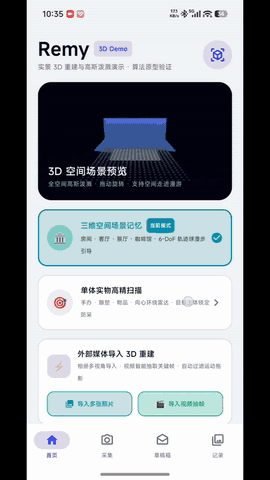
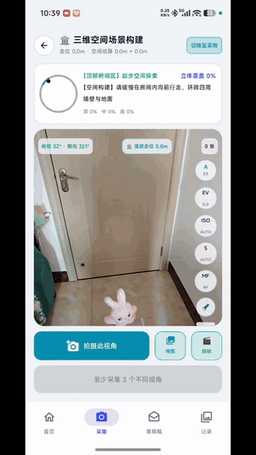
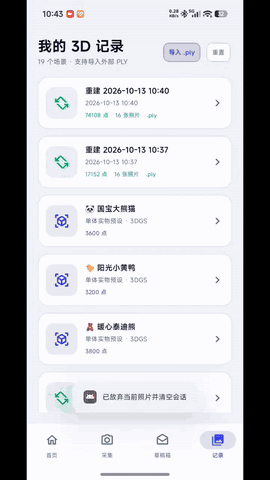

# Remy3D Demo

> **移动端实景 3D 重建与高斯泼溅渲染演示工程 (Mobile Spatial 3D Reconstruction & 3DGS Rendering Demo)**  
> 技术栈：Kotlin + Jetpack Compose + CameraX/Camera2 + Google ARCore + C++ NDK + OpenGL ES 2.0。

[](https://developer.android.com)
[](https://gitee.com/heaven-and-earth-dust/Remy3D-Android/releases/tag/v0.2.0)
[](https://github.com/yxyaxng/Remy3D-Android/releases/tag/v0.2.0)
[](docs/)
[](https://kotlinlang.org/)
[](https://developer.android.com/jetpack/compose)
[](https://www.khronos.org/opengles/)
[](LICENSE)

---

> [!NOTE]
> **项目定位声明**：本项目为一个用于**学习研究、技术验证与流程展示的原型演示工程 (Prototype / Proof-of-Concept Demo)**。  
> 项目参考了开源 3D Gaussian Splatting (Inria)、经典 SfM 多视角立体几何算法以及移动端实时计算机图形学设计，旨在验证在 Android 移动端完成“数据采集 → 质量评估 → 几何特征反投影 → 3DGS 格式解析 → 移动端硬件着色渲染”的端到端交互链路。

---

## 🎬 实机运行演示 (Live Demo)

| 1. 单体拍摄、画质评估与端侧校验 | 2. 36 单元空间穹顶引导与 360° 环绕采集 | 3. 外部 3DGS PLY 模型导入与 60FPS 交互 |
| :---: | :---: | :---: |
|  |  |  |
| **Pro 参数锁定 · 模糊/偏移实时监测 · 机位比对** | **3×12 立体半球雷达 · 实时姿态追踪** | **二进制/ASCII PLY 解析 · 360° 轨道旋转** |

---

## 📚 安装包下载、源码包与技术 Wiki 导航

所有内部文档均采用**平台自适应相对路径**（在 Gitee 点击即停留在 Gitee，在 GitHub 点击即停留在 GitHub），并提供 **Gitee 国内源** 与 **GitHub 国际源** 双通道下载：

| 资源 / 文档 | 内容说明 | 一键下载 / 查阅入口 |
| :--- | :--- | :--- |
| 📦 **Android 正式安装包 (`v0.2.0`)** | **`Remy3D-v0.2.0-release.apk` (16.1 MB)**，包含 C++ NDK 与内置 6 款 3DGS 预设模型 | **[🚀 Gitee 下载页](release/Remy3D-v0.2.0-release.apk)** · **[🚀 Gitee 发行版](https://gitee.com/heaven-and-earth-dust/Remy3D-Android/releases/tag/v0.2.0)** · **[🌍 GitHub 直下 APK](https://github.com/yxyaxng/Remy3D-Android/releases/download/v0.2.0/Remy3D-v0.2.0-release.apk)** |
| 🗜️ **项目源码压缩包 (`Source Code`)** | `v0.2.0` 完整工程源码与文档打包下载 | **[🚀 Gitee 发行版与源码](https://gitee.com/heaven-and-earth-dust/Remy3D-Android/releases/tag/v0.2.0)** · **[🌍 GitHub Source (.zip)](https://github.com/yxyaxng/Remy3D-Android/archive/refs/tags/v0.2.0.zip)** · **[(.tar.gz)](https://github.com/yxyaxng/Remy3D-Android/archive/refs/tags/v0.2.0.tar.gz)** |
| 📖 **在线 Wiki 知识库** | 包含空间采样推导、工程问答 (Q&A)、系统架构手册与曲面重构规范 | **[🚀 Gitee Wiki 知识库](https://gitee.com/heaven-and-earth-dust/Remy3D-Android/wikis)** · **[🌍 GitHub Wiki 知识库](https://github.com/yxyaxng/Remy3D-Android/wiki)** · **[📂 `docs/` 目录](docs/)** |
| 📘 **[`docs/WIKI_SAMPLING_AND_RENDERING.md`](docs/WIKI_SAMPLING_AND_RENDERING.md)** | **Wiki 专题一**：7 类空间采样算法与 3DGS 渲染物理推导 | **[👉 点击阅读文档](docs/WIKI_SAMPLING_AND_RENDERING.md)** |
| 📗 **[`docs/WIKI_TECHNICAL_QA.md`](docs/WIKI_TECHNICAL_QA.md)** | **Wiki 专题二**：移动端 3D 重建与原生工程技术问答（Q&A） | **[👉 点击阅读文档](docs/WIKI_TECHNICAL_QA.md)** |
| 📙 **[`docs/PROJECT_TECHNICAL_MANUAL.md`](docs/PROJECT_TECHNICAL_MANUAL.md)** | **核心技术架构与模块实现手册**（系统架构拓扑与 9 大核心模块细节） | **[👉 点击阅读文档](docs/PROJECT_TECHNICAL_MANUAL.md)** |
| 📒 **[`docs/TECHNICAL_SPEC.md`](docs/TECHNICAL_SPEC.md)** | **端侧曲面重构方案与开源生态规范**（SurfaceMesher 流水线与开源选型对比） | **[👉 点击阅读文档](docs/TECHNICAL_SPEC.md)** |
| 🎯 **[`docs/TECHNICAL_SHOWCASE.html`](docs/TECHNICAL_SHOWCASE.html)** | **核心算法原理与工程技术问答交互页**（支持键盘 `←`/`→` 分步浏览与全文通览） | **[👉 查看源码 / 浏览器打开](docs/TECHNICAL_SHOWCASE.html)** |
| 🖥️ **[`docs/PRESENTATION.html`](docs/PRESENTATION.html)** | **15 页技术架构演示幻灯片**（涵盖系统架构、Camera2 控制、SurfaceMesher 与实测指标） | **[👉 查看源码 / 浏览器打开](docs/PRESENTATION.html)** |

---

## 一、 核心算法与渲染原理（精选示例）

> 完整 7 类空间采样算法与 6 项 3DGS 物理渲染推导请查阅 **[`docs/WIKI_SAMPLING_AND_RENDERING.md`](docs/WIKI_SAMPLING_AND_RENDERING.md)**。

### 示例 1：梯度显著性分箱采样与体素网格空间哈希降噪
- **分箱配额采样 ([`PhotoReconstructor.kt`](app/src/main/java/com/example/remy3d/engine/PhotoReconstructor.kt))**：利用二维 Sobel 算子计算像素亮度梯度幅值 $M(x, y) = \sqrt{G_x^2 + G_y^2}$。为避免仅按高梯度采样导致物体内部表面缺失，单图划分 **2,500 个高梯度边缘点**（锁定几何轮廓）+ **3,500 个平滑表面采样点**（均匀填充内部色彩）。
- **体素空间哈希聚类 ([`SurfaceMesher.kt`](app/src/main/java/com/example/remy3d/engine/SurfaceMesher.kt))**：将连续 3D 空间离散化为尺寸 $v_{\text{size}}$ 的立方体体素，通过空间哈希函数 $H(i, j, k) = (i \cdot 73856093) \oplus (j \cdot 19349663) \oplus (k \cdot 83492791)$ 实现 $O(1)$ 查找，取体素内点集质心替代散点，滤除离群噪点（Floaters）。

### 示例 2：3DGS 椭球参数化、逆 Sigmoid 解码与屏幕 Gamma 还原
- **三维协方差正定分解 ([`UniversalPlyLoader.kt`](app/src/main/java/com/example/remy3d/engine/UniversalPlyLoader.kt))**：将高斯核协方差分解为四元数旋转矩阵 $R$ 与对角尺度矩阵 $S$（$\Sigma = R S S^T R^T$），并对 PLY 中的 `opacity` 执行标准 Sigmoid 激活还原 $\alpha = \frac{1}{1 + \exp(-\text{raw\_opacity})}$。
- **线性辐射空间至屏幕 sRGB 转换 ([`GaussianRenderer.kt`](app/src/main/java/com/example/remy3d/gl/GaussianRenderer.kt))**：在片元着色器中施加 **28% 饱和度自适应补偿** 与 **Gamma 1.85 校正**，配合深黑 3D 渲染视口（`#06101E`），还原标准 3DGS 模型的色彩与边缘对比度。

### 示例 3：360° 球面轨道旋转与实时视线深度重排序
- **AABB 质心归零 + 球面极坐标轨道相机**：加载模型时自动计算包围盒中心并归一化至原点 $(0,0,0)$。旋转时保持模型顶点静止，由水平偏航角 $\theta_{\text{yaw}}$ 与垂直俯仰角 $\phi_{\text{pitch}}$ 驱动摄像机沿球面轨道运动：
  $$e_x = T_x + R\cos\phi_{\text{pitch}}\sin\theta_{\text{yaw}}, \quad e_y = T_y + R\sin\phi_{\text{pitch}}, \quad e_z = T_z + R\cos\phi_{\text{pitch}}\cos\theta_{\text{yaw}}$$
- **C++ NDK 视线深度基数排序 + 屏幕 Billboard 展开**：相机每旋转一帧，C++ 层实时计算各椭球在当前视线方向上的投影深度 $z_i = (\mathbf{p}'_i - \mathbf{E}) \cdot \vec{d}$ 并执行基数排序（Radix Sort），配合顶点着色器裁剪空间展开，确保 360° 任意角度下前后遮挡关系准确。

---

## 二、 移动端全链路核心模块速览

| 阶段 | 核心源码模块 | 关键技术机制 |
| :--- | :--- | :--- |
| **1. 专业相机硬件锁参** | [`NativeProCameraController.kt`](app/src/main/java/com/example/remy3d/camera/NativeProCameraController.kt) | Camera2 互操作层锁定 ISO、纳秒级快门、屈光度微距对焦与白平衡，保持多视角曝光一致 |
| **2. 36 单元立体穹顶引导** | [`SpatialCaptureGuide.kt`](app/src/main/java/com/example/remy3d/engine/SpatialCaptureGuide.kt) | 融合旋转矢量传感器与竖屏坐标重映射，划分 3 层俯仰角 × 12 经度扇区 = 36 单元半球网格 |
| **3. 实时模糊与偏移监测** | [`ImageQualityEvaluator.kt`](app/src/main/java/com/example/remy3d/engine/ImageQualityEvaluator.kt) | 拉普拉斯二阶差分在线方差评估（`< 5ms`）+ 预览流 HSV 直方图与物距实时一致性追踪 |
| **4. 视频流关键帧抽取** | [`VideoKeyframeExtractor.kt`](app/src/main/java/com/example/remy3d/engine/VideoKeyframeExtractor.kt) | `MediaMetadataRetriever` 自适应步长抽帧，结合锐度评估自动过滤运动模糊帧 |
| **5. 端侧反投影与致密化** | [`PhotoReconstructor.kt`](app/src/main/java/com/example/remy3d/engine/PhotoReconstructor.kt) | 分箱特征提取 + 圆弧相机轨道针孔反投影 + [`SurfaceMesher.kt`](app/src/main/java/com/example/remy3d/engine/SurfaceMesher.kt) 曲面插值 |
| **6. 通用 PLY 流式解析** | [`UniversalPlyLoader.kt`](app/src/main/java/com/example/remy3d/engine/UniversalPlyLoader.kt) | 支持 ASCII 与 `binary_little_endian` 标准 3DGS PLY，内置自适应步长控制内存峰值 |
| **7. NDK 排序与相册/PLY导出** | [`GaussianRenderer.kt`](app/src/main/java/com/example/remy3d/gl/GaussianRenderer.kt) | OpenGL ES 2.0 60FPS 渲染、`glReadPixels` 无权限存系统相册 ([`MediaStoreSaver.kt`](app/src/main/java/com/example/remy3d/engine/MediaStoreSaver.kt))、SAF 导出 |

---

## 三、 核心技术问题解析（Q&A 精选）

> 完整工程技术问答请查阅 **[`docs/WIKI_TECHNICAL_QA.md`](docs/WIKI_TECHNICAL_QA.md)** 或 **[`docs/TECHNICAL_SHOWCASE.html`](docs/TECHNICAL_SHOWCASE.html)**。

### Q1: 在拍照采样阶段，传统 Mesh 摄影测量与 3DGS 有什么区别？
**A：**
1. **高光与反光材质处理**：传统 MVS 假设表面各角度颜色恒定（漫反射），移动高光易导致立体匹配失败与网格破洞；**3DGS 利用球谐函数 (SH) 拟合随视角变化的高光**，支持拍摄瓷器、金属等反光表面，需配合多仰角环绕采样。
2. **自动曝光 (AE) 敏感度**：自动曝光的明暗波动会被 3DGS 全图光度损失（$L_1 + \text{D-SSIM}$）拟合为空中悬浮噪点（Floaters），因此需通过 [`NativeProCameraController.kt`](app/src/main/java/com/example/remy3d/camera/NativeProCameraController.kt) 锁定 ISO、快门与白平衡。
3. **半球均匀覆盖**：3DGS 依赖全局视锥交叉约束，需遵循上、中、下三层半球均匀环绕（对应 **36 单元立体穹顶雷达**）。

### Q2: 拍照确认与端侧质检是如何优化到 `< 5ms` 响应的？
**A：**
1. **采集分辨率收敛**：为 `ImageCapture` 配置 `ResolutionSelector(1280×960)` 与 `setJpegQuality(85)`。
2. **后台单次下采样内存复用**：移除主线程全尺寸原图重编码，改为在 `Dispatchers.Default` 后台协程执行 `decodeBitmapWithExif(file, maxSide = 360)` **单次下采样解码并内存复用**。
3. **批量像素读取与单趟方差计算**：使用 `bitmap.getPixels()` 一次性读入 `IntArray`，利用 $\text{Var}(X) = E[X^2] - (E[X])^2$ 单趟零分配计算拉普拉斯方差，单帧质检耗时 **`< 5ms`**。

### Q3: 为什么手机端秒级重建偏稀疏，而外部导入的 3DGS 模型连续光滑？
**A：**
- **端侧秒级重建（`3.5s ~ 7.5s`）**：在手机本地 CPU 算力下执行即时几何特征反投影与局部拓扑插值，无需云端 GPU 即可现场验证采集完整度。
- **桌面/云端 3DGS 训练（`15 ~ 40min`）**：在独立显卡上经历 30,000 轮反向传播迭代，对高斯球执行分裂（Splitting）、克隆（Cloning）与剪枝（Pruning）生成百万级椭球。本项目通过 [`UniversalPlyLoader.kt`](app/src/main/java/com/example/remy3d/engine/UniversalPlyLoader.kt) 支持直接导入并 60FPS 交互渲染外部训练的标准 `.ply` 模型。

---

## 四、 内置 3DGS 预设与性能基准

App 在**「我的 3D 记录」**中内置了 **🐼 国宝大熊猫、🐤 阳光小黄鸭、🧸 暖心泰迪熊、🏺 经典青花瓷、🛋️ 现代轻奢客厅、🏛️ 几何艺术雕塑** 6 款预设模型，支持 360° 轨道旋转、双指缩放平移、一键存相册与导出标准 `.ply`。

| 指标维度 | 实测基准数值 | 说明 |
| :--- | :--- | :--- |
| **端侧几何重建耗时** | **3.2s ~ 7.8s**（15 ~ 30 张图片） | 本地 CPU 协程并发计算，无需联网上传 |
| **图形渲染帧率 (FPS)** | **60 FPS** 稳定运行 | OpenGL ES 2.0 硬件渲染 + C++ NDK 排序 |
| **运行内存占用 (RAM)** | **< 160 MB** | 流式步长采样 + DirectBuffer 零拷贝 |
| **单张模糊质检耗时** | **< 5 ms** | `getPixels` 批量数组 + 单趟在线方差算子 |

---

## 五、 工程目录结构

```text
Remy3D-Android-starter/
├── assets/                                # 实机运行演示 GIF 动图资源
│   ├── 单体拍摄与校验.gif
│   ├── 3D三维36拍摄.gif
│   └── ply导入展示.gif
├── docs/                                  # 项目技术文档、Wiki 专题与可视化演示页
│   ├── PROJECT_TECHNICAL_MANUAL.md        # 核心技术架构与模块实现手册
│   ├── TECHNICAL_SPEC.md                  # 端侧曲面重构方案与生态规范
│   ├── WIKI_SAMPLING_AND_RENDERING.md     # Wiki 专题一：空间采样算法与 3DGS 物理渲染推导
│   ├── WIKI_TECHNICAL_QA.md               # Wiki 专题二：移动端 3D 重建与原生工程技术问答 (Q&A)
│   ├── TECHNICAL_SHOWCASE.html            # 交互式核心算法原理与工程问答页
│   └── PRESENTATION.html                  # 15 页全屏技术架构演示幻灯片
├── release/
│   └── Remy3D-v0.2.0-release.apk          # Android 已签名正式安装包
├── app/src/main/
│   ├── cpp/                               # C++17 NDK 原生 PLY 解析与视线深度基数排序
│   └── java/com/example/remy3d/
│       ├── MainActivity.kt                # 页面路由、相机预览与实时分析、草稿与查看器调度
│       ├── camera/                        # Camera2 底层 ISP 控制 (ISO/快门/对焦锁定)
│       ├── engine/                        # 模糊评估、36单元穹顶、实时主体追踪、视频抽帧、反投影、PLY解析
│       ├── plyio/                         # 标准 PLY 格式流式导出器
│       └── gl/                            # OpenGL ES 2.0 高斯着色器、360°球面轨道相机与NDK桥接
└── README.md                              # 项目概览与文档导航
```

---

## 六、 开源协议 (License)

本项目采用 **Apache License 2.0** 许可证开源。详见工程根目录下的 [LICENSE](LICENSE) 文件。
